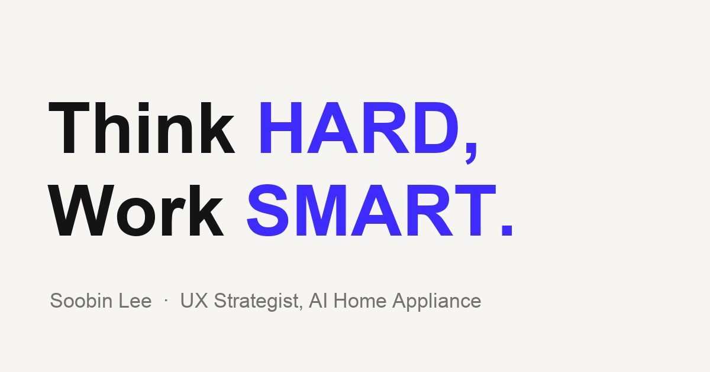

<p align="center">
  
</p>

<h1 align="center">Soobin Lee — Portfolio</h1>

<p align="center">
  AI 가전의 UX를 기획하는 이수빈의 개인 웹사이트이자 포트폴리오입니다.<br>
  리서치에서 서비스 구조, 인터랙션, GUI까지 이어지는 설계 과정을 기록합니다.
</p>

<p align="center">
  <a href="https://soobin-lee-studio.github.io"><strong>soobin-lee-studio.github.io</strong></a>
  &nbsp;·&nbsp;
  <a href="https://soobin-lee-studio.github.io/?lang=en">English</a>
</p>

---

## About

**이수빈 (Soobin Lee)** · UX 기반 기획자, 선임<br>
LG전자 HS사업본부 AI가전기획팀

사용자가 망설이는 순간을 리서치로 찾고, AI가 언제 제안하고 언제 기다릴지를 설계합니다.
한국·일본·북미 사용자 조사에서 출발해 서비스 구조, 인터랙션, GUI를 하나의 흐름으로 연결합니다.

| Focus | |
| --- | --- |
| AI Agent UX | 개입 타이밍, 통제권, 신뢰 설계 |
| User Research | FGD · 가정 방문 심층 인터뷰 · 프로토타입 UT |
| Service Strategy | 서비스 구조화 · 가치 순환 모델 · 로드맵 |
| Interaction & GUI | LCD UI · Voice·Touch 멀티모달 |

## Selected Projects

| Project | Period | Role | Highlights |
| --- | --- | --- | --- |
| [**AI Oven: Sous Chef Agent**](https://soobin-lee-studio.github.io/projects/sous-chef-agent.html)<br><sub>조리 상황에 맞춰 개입하는 오븐 AI Agent</sub> | 2026.02 – 2026.07 | UX Strategy & Research Lead (60%) | 12개 AI 기능 → 3개 서비스 구조화, 북미 UT(n=20) 검증, '27–'28 로드맵 |
| [**AI Refrigerator: Food Intelligence**](https://soobin-lee-studio.github.io/projects/food-intelligence.html)<br><sub>데이터가 쌓이는 식재료 플랫폼</sub> | 2023.08 – 2025.02 | AI Service Planning & GUI Lead (50%) | CES 2025 전시, 본부 Creative Award 수상 |

> 출시 전이거나 보안이 필요한 정보는 기업 가이드라인에 따라 마스킹 처리했습니다.

## Site Structure

```
.
├── index.html                  # Home — statement + project grid
├── about.html                  # About — 소개, 현재, 주요 성과, 역량
├── projects/
│   ├── sous-chef-agent.html    # Case study 01
│   └── food-intelligence.html  # Case study 02
└── assets/
    ├── css/style.css           # Design tokens, layout, light/dark theme
    ├── js/main.js              # Language & theme toggle, scroll reveal, TOC, lightbox
    └── img/                    # Optimized images (profile, covers, slides)
```

## Design & Tech

- **Archival minimal** — 흰 배경, 절제된 타이포그래피, 장식 없는 라인 기반 레이아웃
- **Typography** — [Pretendard](https://github.com/orioncactus/pretendard) 단일 서체(고딕), 굵기와 명도로만 위계 구성
- **Bilingual (KO / EN)** — 헤더 토글로 전환, 선택 언어 저장 · `?lang=en` 쿼리 지원
- **Case study layout** — 번호 챕터 + 스크롤 위치를 따라가는 sticky 목차, 슬라이드 클릭 확대
- **Light / Dark** — 시스템 설정을 따르고, 헤더 토글로 전환 (선택 값 저장)
- **Accessible & responsive** — 시맨틱 마크업, 키보드 포커스, `prefers-reduced-motion` 대응, 375px 모바일까지 대응
- **Zero build** — 순수 HTML / CSS / JavaScript, GitHub Pages에서 그대로 배포 (`.nojekyll`)

## Local Development

빌드 과정이 없으므로 정적 서버만 띄우면 됩니다.

```bash
python3 -m http.server 4173
```

이후 <http://localhost:4173> 에서 확인합니다.

## Deployment

`main` 브랜치에 푸시하면 GitHub Pages가 루트(`/`)를 기준으로 자동 배포합니다.
(Settings → Pages → Branch: `main` / `/ (root)`)

## License

© 2026 Soobin Lee. All rights reserved.
포트폴리오 내 프로젝트 이미지와 내용은 무단 사용·재배포를 금합니다.
